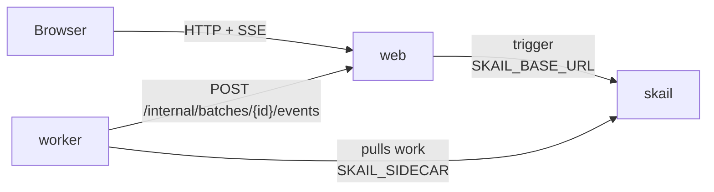

# skail batch billing (Node / TypeScript + React)

[Português (Brasil)](README.pt-BR.md)

A skail function bills a batch of orders: it asks the city hall for one service invoice per order, in waves of 10, and consolidates the result when every invoice is done. Each invoice is a child run with its own history, so when the city hall is unavailable, skail retries only that invoice and the others go on. An authorized invoice sends the PDF to the customer; a rejected or pending invoice goes to finance, and the batch does not stop. The city hall is simulated and is unavailable on about 1 call in 10. A React page starts a batch of 10, 20 or 50 invoices and shows each invoice, the customer's mailbox and the finance ticket queue.

The demo covers three topics of the [skail docs](https://docs.skail.dev) (in Portuguese):

- [fan-out and fan-in](https://docs.skail.dev/construa/como-fazer/padroes-e-antipadroes/fan-out-fan-in): one child run per invoice, in waves of 10, joined by a wait for all of them;
- [retries and idempotence](https://docs.skail.dev/construa/conceitos/retries-e-idempotencia): an outage at the city hall retries only that invoice, with the order id as the idempotency key;
- [handling errors](https://docs.skail.dev/construa/como-fazer/tratar-erros-e-desfazer-passos): a rejection is a result, not an exception, and an invoice that fails on every attempt becomes pending.

## How it works



- **worker** (`apps/worker`): the functions `BillBatch(batchId, size)` and `IssueInvoice(batchId, size, order)` and their commands. `IssueAtCityHall` asks the city hall for the invoice, `SendPdfToCustomer` sends the PDF of an authorized invoice, `NotifyFinance` opens a ticket for a rejected or pending invoice, and `ReportStatus` tells the web page how the batch is going. The commands delegate to `BillingOperations`, so their logic is tested without skail. The city hall is simulated in [`city-hall.ts`](apps/worker/src/city-hall.ts).
- **web** (`apps/web`): API and static files. It starts the batch (trigger), plays the customer's mailbox and the finance ticket queue, keeps the state in memory and streams it to the page (SSE).
- **frontend** (`apps/frontend`): the page, in React 18, Vite and TypeScript.
- **contracts** (`apps/contracts`): types, constants and pure rules shared by the other three. It also goes into the skail bundle, so it has no Node I/O imports.

The functions only orchestrate and leave the I/O to the commands. Simplified from [`billing-functions.ts`](apps/worker/src/billing-functions.ts), which also reports each step to the page:

```ts
async BillBatch(batchId: string, size: number): Promise<BatchResult> {
  const orders = Orders.generate(batchId, size);
  const invoices: Invoice[] = [];
  for (const wave of chunk(orders, BatchLimits.waveSize)) {
    const issuing = wave.map((order) => this.IssueInvoice(batchId, size, order));
    invoices.push(...(await Skail.whenAll(issuing)));
  }
  return BatchResult.consolidate(batchId, invoices);
}

async IssueInvoice(batchId: string, size: number, order: Order): Promise<Invoice> {
  let invoice: Invoice;
  try {
    invoice = await this.IssueAtCityHall(batchId, size, order);
  } catch (error) {
    if (error instanceof SkailNonDeterministicError) throw error;
    invoice = Invoice.pending(order, "city hall unavailable");
  }
  if (isAuthorized(invoice)) await this.SendPdfToCustomer(batchId, size, invoice);
  else await this.NotifyFinance(batchId, size, invoice);
  return invoice;
}
```

The orders come from arithmetic over the batch id and the size, so `BillBatch` stays deterministic; in a real system a command would load them. Each `IssueInvoice` call becomes a child run, with its own history and its own entry in the Monitor. The function creates the 10 child runs of a wave before waiting, so they run in parallel, and the next wave starts when the current one ends. That way the city hall never gets more than 10 requests at once. `whenAll` returns the invoices of the wave in the order they were created, not in the order they finished.

A rejected or pending invoice is a result: the city hall answered, and `NotifyFinance` hands it to finance. Only an outage throws, so skail retries `IssueAtCityHall` for that invoice, up to 5 times. If every attempt fails, `IssueInvoice` catches the error and the invoice becomes pending, so the batch always completes. The order id (batch id and order number) is the idempotency key at the city hall: a retry of the same order gets the same invoice number and protocol.

## The paths

The web page has a **Batch size** list (10, 20 or 50 invoices) and a **Start** button. The simulated city hall rejects the orders whose number is a multiple of 5 (invalid customer tax id), leaves pending the multiples of 7 and authorizes the rest.

| What you do | What happens | Result |
|---|---|---|
| **Start** with 20 invoices | two waves of 10 invoices, one child run per invoice | **Completed**: 14 authorized, 4 rejected, 2 pending |
| **Start** with 50 invoices | five waves of 10 | **Completed**: 34 authorized, 10 rejected, 6 pending |
| any batch, when the city hall is unavailable on a call | skail retries that invoice only; its row shows more than 1 attempt | the same result |
| `scripts/run.sh kill-worker` in the middle of a batch, then `scripts/run.sh start-worker` | the batch continues, and the invoices already issued are not issued again | **Completed**, each invoice in one inbox, once |

The **Customer inbox** gets the PDFs of the authorized invoices, such as `NF-000001.pdf`. The **Finance inbox** gets a ticket for each rejected or pending invoice, with the reason. An invoice never shows up in both, nor twice in the same one. The summary shows the counts and the amount billed, which adds only the authorized invoices.

## How it connects to skail

| Service | Variable | Used for |
|---|---|---|
| worker | `SKAIL_SIDECAR` | Connects the functions to your environment and receives their work. |
| web | `SKAIL_BASE_URL` | Starts batches through the skail HTTP API. |

Both use the same `SKAIL_WORKLOAD`, `SKAIL_NAMESPACE` and `SKAIL_KEY`. The web app makes one call per batch:

```http
POST {SKAIL_BASE_URL}/api/v1/trigger/{name}/{version}/BillBatch/{batchId}
["{batchId}", 20]
```

`{name}` and `{version}` come from `SKAIL_WORKLOAD` (`name:version`). The call sends the key in `skail-key` and in `Authorization: Bearer`, plus the `Skail-namespace` header, as described in [authentication](https://docs.skail.dev/referencia/api-http/autenticacao). `429`, `5xx` and network errors are retried with the same batch id. `401` and `403` are not retried: check `SKAIL_KEY` and `SKAIL_NAMESPACE`.

The browser never calls skail. It only talks to the web app, so the key stays on the server.

## Requirements

- Node 20, 22 or 24 and pnpm 10 (`npm i -g pnpm@10.34.7`)
- podman or docker
- PowerShell 7+ (`pwsh`), only if you use `scripts/run.ps1` instead of `scripts/run.sh`
- A skail environment with the workload from `SKAIL_WORKLOAD` registered (`batchbilling:v1.0.0` by default). The [Quickstart](https://docs.skail.dev/comece-aqui/quickstart) shows how to get an account, create the environment and register the workload.
- Access to the public npm registry, where `@skail/runtime`, `@skail/testing` (2.0.1-rc1) and `@skail/build` (2.0.0) come from.
- A current browser (Chrome/Edge 111+, Firefox 113+, Safari 16.2+). The page uses Server-Sent Events.

## Configure

```bash
cp .env.example .env     # .env holds the key and is ignored by git
```

Fill in `SKAIL_WORKLOAD` (exactly as registered in the portal), `SKAIL_NAMESPACE`, `SKAIL_KEY`, `SKAIL_SIDECAR` and `SKAIL_BASE_URL` with the values of your environment.

The skail bundle cannot read environment variables, so the worker gets `SKAIL_WORKLOAD`, `WEB_BASE_URL`, `CITY_HALL_PROVIDER` and `CITY_HALL_OUTAGE_PERCENT` when it is built ([`gen-config.mjs`](apps/worker/scripts/gen-config.mjs)). After changing them in `.env`, build again; `scripts/run.sh up` does it. `MONITOR_URL`, optional, belongs to the web app and adds a link to the skail Monitor on the page.

## Run with podman or docker

```bash
scripts/run.sh up        # builds both images and starts web + worker
scripts/run.sh logs
scripts/run.sh down
```

`CONTAINER_ENGINE=docker` forces docker. On Windows, or anywhere with PowerShell 7+, run `pwsh scripts/run.ps1 <command>` with the same commands; `$env:CONTAINER_ENGINE = "docker"` forces docker.

Open <http://localhost:8080>, choose the batch size and press **Start**.

### See the durability

1. Choose 50 invoices and press **Start**.
2. After the first waves, run `scripts/run.sh kill-worker`. It kills the worker with SIGKILL, like a crash; the batch stops, and the web app keeps the page state.
3. Run `scripts/run.sh start-worker`.
4. The batch continues and ends with the 50 invoices. The invoices issued before the crash are not issued again, and each one shows up in a single inbox, once.

In the portal, open the [Monitor](https://docs.skail.dev/referencia/portal/monitor) of your environment and search for the batch id, which the web page shows at the bottom. The run lists `ReportStatus`, the `IssueInvoice` child runs inside `WhenAll`, and a final `ReportStatus`. Each `IssueInvoice` shows its own commands: `IssueAtCityHall`, then `SendPdfToCustomer` or `NotifyFinance`, then `ReportStatus`. An invoice retried after an outage shows the error next to its `IssueAtCityHall`. In a batch of 20, **E2E Duration** was 19.4 s and **Duration** was 1.2 s, because the waits for the child runs do not use the worker.

## VS Code

Open the folder and accept the recommended extensions.

- `Ctrl+Shift+B` builds, the *test* task runs the tests and the `containers: up/down/logs/kill-worker/start-worker` tasks call `scripts/run.sh`.
- The **Worker + Web** debug configuration starts both apps reading `.env`, and a breakpoint inside a command works. Its build task bakes `WEB_BASE_URL=http://localhost:8080` into the bundle, because outside containers the web app is on `localhost`.
- For the page with hot reload, run the `dev: front end (vite)` task. It forwards `/api` to the web app on port 8080.

## Tests

```bash
pnpm install
pnpm test
```

The unit tests cover the contracts, the simulated city hall, the operations behind the commands, the functions in memory with `@skail/testing` (one child run per invoice, 5 waves of 10 in a batch of 50, an outage retried on one invoice only, an invoice that fails on every attempt becoming pending, the consolidation), the `skail build` of the worker, the batch store (inboxes, repeated events), the calls to skail (trigger), the web API with SSE and the React page. They need neither network nor skail.

## Notes

- The state of the batches lives in the memory of the web app. Restarting it loses the page history; the batch keeps running in skail, but the web app ignores the events of batches it does not know.
- The city hall is simulated in the worker. `CITY_HALL_OUTAGE_PERCENT` sets how often it is unavailable (10 by default), and `CITY_HALL_PROVIDER=fake` turns off the outages and the latency.
- There is no button to stop a batch: once started, it runs to the end.
- The `POST /internal/batches/{id}/events` route, which the worker calls, has no authentication. That is fine for a local demo; protect it before using the pattern in production.
- Workers with the same `SKAIL_WORKLOAD` on the same environment share the same runs: use one workload (or environment) per person.

## License

[Apache-2.0](LICENSE)
