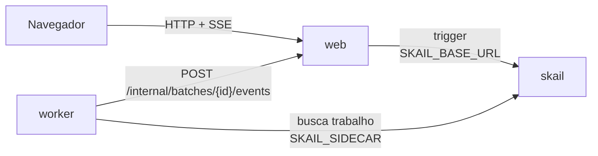

# skail batch billing (Node / TypeScript + React)

[English](README.md)

Uma function do skail fatura um lote de pedidos: pede à prefeitura uma nota fiscal de serviço por pedido, em ondas de 10, e consolida o resultado quando todas as notas terminam. Cada nota é uma execução filha com o próprio histórico, então quando a prefeitura está fora do ar, o skail repete só aquela nota e as outras seguem. Uma nota autorizada manda o PDF para o cliente; uma nota rejeitada ou pendente vai para o financeiro, e o lote não para. A prefeitura é simulada e fica fora do ar em cerca de 1 chamada a cada 10. Uma página React inicia um lote de 10, 20 ou 50 notas e mostra cada nota, a caixa de e-mail do cliente e a fila de chamados do financeiro.

A demo mostra três tópicos da [documentação do skail](https://docs.skail.dev):

- [fan-out e fan-in](https://docs.skail.dev/construa/como-fazer/padroes-e-antipadroes/fan-out-fan-in): uma execução filha por nota, em ondas de 10, juntadas por uma espera por todas;
- [retries e idempotência](https://docs.skail.dev/construa/conceitos/retries-e-idempotencia): uma queda da prefeitura repete só aquela nota, com o id do pedido como chave de idempotência;
- [tratar erros](https://docs.skail.dev/construa/como-fazer/tratar-erros-e-desfazer-passos): uma rejeição é um resultado, não uma exceção, e uma nota que falha em todas as tentativas vira pendente.

## Como funciona



- **worker** (`apps/worker`): as functions `BillBatch(batchId, size)` e `IssueInvoice(batchId, size, order)` e os commands delas. O `IssueAtCityHall` pede a nota à prefeitura, o `SendPdfToCustomer` manda o PDF de uma nota autorizada, o `NotifyFinance` abre um chamado para uma nota rejeitada ou pendente, e o `ReportStatus` avisa a página web do andamento do lote. Os commands delegam para o `BillingOperations`, então a lógica deles é testada sem o skail. A prefeitura é simulada no [`city-hall.ts`](apps/worker/src/city-hall.ts).
- **web** (`apps/web`): API e arquivos estáticos. Inicia o lote (trigger), faz o papel da caixa de e-mail do cliente e da fila de chamados do financeiro, guarda o estado em memória e transmite para a página (SSE).
- **frontend** (`apps/frontend`): a página, em React 18, Vite e TypeScript.
- **contracts** (`apps/contracts`): tipos, constantes e regras puras usados pelos outros três. Ele também entra no bundle do skail, por isso não importa módulos de I/O do Node.

As functions só orquestram e deixam o I/O para os commands. O trecho abaixo é uma versão simplificada do [`billing-functions.ts`](apps/worker/src/billing-functions.ts), que também avisa a página de cada etapa:

```ts
async BillBatch(batchId: string, size: number): Promise<BatchResult> {
  const orders = Orders.generate(batchId, size);
  const invoices: Invoice[] = [];
  for (const wave of chunk(orders, BatchLimits.waveSize)) {
    const issuing = wave.map((order) => this.IssueInvoice(batchId, size, order));
    invoices.push(...(await Skail.whenAll(issuing)));
  }
  return BatchResult.consolidate(batchId, invoices);
}

async IssueInvoice(batchId: string, size: number, order: Order): Promise<Invoice> {
  let invoice: Invoice;
  try {
    invoice = await this.IssueAtCityHall(batchId, size, order);
  } catch (error) {
    if (error instanceof SkailNonDeterministicError) throw error;
    invoice = Invoice.pending(order, "city hall unavailable");
  }
  if (isAuthorized(invoice)) await this.SendPdfToCustomer(batchId, size, invoice);
  else await this.NotifyFinance(batchId, size, invoice);
  return invoice;
}
```

Os pedidos vêm de uma conta sobre o id do lote e o tamanho, então o `BillBatch` continua determinístico; num sistema de verdade, um command carregaria os pedidos. Cada chamada a `IssueInvoice` vira uma execução filha, com o próprio histórico e a própria entrada no Monitor. A function cria as 10 execuções filhas de uma onda antes de esperar, então elas rodam em paralelo, e a onda seguinte começa quando a atual termina. Assim a prefeitura nunca recebe mais de 10 pedidos ao mesmo tempo. O `whenAll` devolve as notas da onda na ordem em que foram criadas, não na ordem em que terminaram.

Uma nota rejeitada ou pendente é um resultado: a prefeitura respondeu, e o `NotifyFinance` passa a nota para o financeiro. Só uma queda lança exceção, então o skail repete o `IssueAtCityHall` daquela nota, até 5 vezes. Se todas as tentativas falharem, o `IssueInvoice` captura o erro e a nota vira pendente, então o lote sempre termina. O id do pedido (id do lote e número do pedido) é a chave de idempotência na prefeitura: uma nova tentativa do mesmo pedido recebe o mesmo número de nota e o mesmo protocolo.

## Os caminhos

A página web tem a lista **Batch size** (10, 20 ou 50 notas) e o botão **Start**. A prefeitura simulada rejeita os pedidos com número múltiplo de 5 (CNPJ do cliente inválido), deixa pendentes os múltiplos de 7 e autoriza o resto.

| O que você faz | O que acontece | Resultado |
|---|---|---|
| **Start** com 20 notas | duas ondas de 10 notas, uma execução filha por nota | **Completed**: 14 autorizadas, 4 rejeitadas, 2 pendentes |
| **Start** com 50 notas | cinco ondas de 10 | **Completed**: 34 autorizadas, 10 rejeitadas, 6 pendentes |
| qualquer lote, quando a prefeitura cai numa chamada | o skail repete só aquela nota; a linha dela mostra mais de 1 tentativa | o mesmo resultado |
| `scripts/run.sh kill-worker` no meio de um lote, depois `scripts/run.sh start-worker` | o lote continua, e as notas já emitidas não são emitidas de novo | **Completed**, cada nota numa caixa, uma vez só |

A **Customer inbox** recebe os PDFs das notas autorizadas, como `NF-000001.pdf`. A **Finance inbox** recebe um chamado para cada nota rejeitada ou pendente, com o motivo. Uma nota nunca aparece nas duas, nem duas vezes na mesma. O resumo mostra as contagens e o valor faturado, que soma só as notas autorizadas.

## Como conecta ao skail

| Serviço | Variável | Para quê |
|---|---|---|
| worker | `SKAIL_SIDECAR` | Conecta as functions ao seu environment e recebe o trabalho delas. |
| web | `SKAIL_BASE_URL` | Inicia lotes pela API HTTP do skail. |

Os dois usam os mesmos `SKAIL_WORKLOAD`, `SKAIL_NAMESPACE` e `SKAIL_KEY`. O web faz uma chamada por lote:

```http
POST {SKAIL_BASE_URL}/api/v1/trigger/{nome}/{versao}/BillBatch/{batchId}
["{batchId}", 20]
```

`{nome}` e `{versao}` vêm de `SKAIL_WORKLOAD` (`nome:versao`). A chamada manda a chave em `skail-key` e em `Authorization: Bearer`, mais o header `Skail-namespace`, como descrito em [autenticação](https://docs.skail.dev/referencia/api-http/autenticacao). `429`, `5xx` e erros de rede são repetidos com o mesmo id do lote. `401` e `403` não são repetidos: confira `SKAIL_KEY` e `SKAIL_NAMESPACE`.

O navegador nunca chama o skail. Ele só fala com o web, então a chave fica no servidor.

## Requisitos

- Node 20, 22 ou 24 e pnpm 10 (`npm i -g pnpm@10.34.7`)
- podman ou docker
- PowerShell 7+ (`pwsh`), só se você usar o `scripts/run.ps1` em vez do `scripts/run.sh`
- Um environment do skail com o workload de `SKAIL_WORKLOAD` cadastrado (`batchbilling:v1.0.0` por padrão). O [Quickstart](https://docs.skail.dev/comece-aqui/quickstart) mostra como pedir a conta, criar o environment e cadastrar o workload.
- Acesso ao registro público do npm, de onde vêm `@skail/runtime`, `@skail/testing` (2.0.1-rc1) e `@skail/build` (2.0.0).
- Um navegador atual (Chrome/Edge 111+, Firefox 113+, Safari 16.2+). A página usa Server-Sent Events.

## Configurar

```bash
cp .env.example .env     # o .env guarda a chave e é ignorado pelo git
```

Preencha `SKAIL_WORKLOAD` (exatamente como está cadastrado no portal), `SKAIL_NAMESPACE`, `SKAIL_KEY`, `SKAIL_SIDECAR` e `SKAIL_BASE_URL` com os valores do seu environment.

O bundle do skail não lê variáveis de ambiente, então o worker recebe `SKAIL_WORKLOAD`, `WEB_BASE_URL`, `CITY_HALL_PROVIDER` e `CITY_HALL_OUTAGE_PERCENT` no build ([`gen-config.mjs`](apps/worker/scripts/gen-config.mjs)). Depois de mudar esses valores no `.env`, faça o build de novo; o `scripts/run.sh up` já faz isso. O `MONITOR_URL`, opcional, é do web e coloca na página um link para o Monitor do skail.

## Rodar com podman ou docker

```bash
scripts/run.sh up        # builda as duas imagens e sobe web + worker
scripts/run.sh logs
scripts/run.sh down
```

`CONTAINER_ENGINE=docker` força o docker. No Windows, ou em qualquer sistema com PowerShell 7+, rode `pwsh scripts/run.ps1 <comando>` com os mesmos comandos; `$env:CONTAINER_ENGINE = "docker"` força o docker.

Abra <http://localhost:8080>, escolha o tamanho do lote e clique em **Start**.

### Ver a durabilidade

1. Escolha 50 notas e clique em **Start**.
2. Depois das primeiras ondas, rode `scripts/run.sh kill-worker`. Ele mata o worker com SIGKILL, como numa queda; o lote para, e o web mantém o estado da página.
3. Rode `scripts/run.sh start-worker`.
4. O lote continua e termina com as 50 notas. As notas emitidas antes da queda não são emitidas de novo, e cada uma aparece numa caixa só, uma vez.

No portal, abra o [Monitor](https://docs.skail.dev/referencia/portal/monitor) do seu environment e procure pelo id do lote, que a página web mostra no rodapé. A execução lista o `ReportStatus`, as execuções filhas `IssueInvoice` dentro do `WhenAll` e um `ReportStatus` no fim. Cada `IssueInvoice` mostra os próprios commands: o `IssueAtCityHall`, depois o `SendPdfToCustomer` ou o `NotifyFinance`, depois o `ReportStatus`. Uma nota repetida depois de uma queda mostra o erro ao lado do `IssueAtCityHall` dela. Num lote de 20, o **E2E Duration** foi de 19,4 s e o **Duration** de 1,2 s, porque as esperas pelas execuções filhas não ocupam o worker.

## VS Code

Abra a pasta e aceite as extensões recomendadas.

- `Ctrl+Shift+B` compila, a task *test* roda os testes e as tasks `containers: up/down/logs/kill-worker/start-worker` chamam o `scripts/run.sh`.
- A configuração de debug **Worker + Web** sobe os dois apps lendo o `.env`, e um breakpoint dentro de um command funciona. A task de build dela grava `WEB_BASE_URL=http://localhost:8080` no bundle, porque fora de container o web fica em `localhost`.
- Para a página com hot reload, rode a task `dev: front end (vite)`. Ela repassa `/api` para o web na porta 8080.

## Testes

```bash
pnpm install
pnpm test
```

Os testes unitários cobrem os contratos, a prefeitura simulada, as operações por trás dos commands, as functions em memória com `@skail/testing` (uma execução filha por nota, 5 ondas de 10 num lote de 50, uma queda repetida só numa nota, uma nota que falha em todas as tentativas e vira pendente, a consolidação), o `skail build` do worker, o estado dos lotes (caixas de entrada, eventos repetidos), as chamadas ao skail (trigger), a API web com SSE e a página React. Eles não precisam de rede nem do skail.

## Observações

- O estado dos lotes fica na memória do web. Reiniciar o web perde o histórico da página; o lote continua rodando no skail, mas o web ignora os eventos de lotes que ele não conhece.
- A prefeitura é simulada no worker. O `CITY_HALL_OUTAGE_PERCENT` define com que frequência ela fica fora do ar (10 por padrão), e o `CITY_HALL_PROVIDER=fake` desliga as quedas e a latência.
- Não há botão para parar um lote: depois de iniciado, ele vai até o fim.
- A rota `POST /internal/batches/{id}/events`, que o worker chama, não tem autenticação. Para uma demo local isso basta; proteja a rota antes de usar o padrão em produção.
- Workers com o mesmo `SKAIL_WORKLOAD` no mesmo environment dividem as mesmas execuções: use um workload (ou environment) por pessoa.

## Licença

[Apache-2.0](LICENSE)
